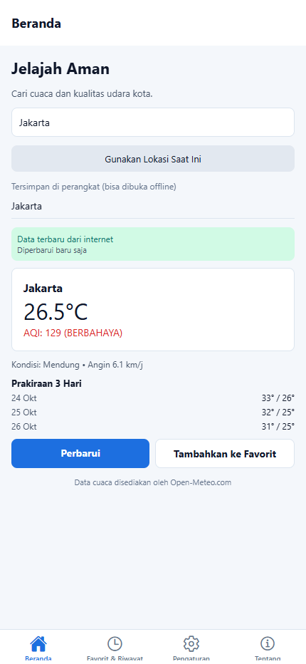

# LAPORAN PRAKTIKUM UTS

## Pemrograman Berbasis Platform

### Aplikasi “Jelajah Aman”

---

## Identitas Mahasiswa

| Keterangan | Isi |
| --- | --- |
| Nama | Muhammad Fatkhunihadh |
| NIM | 60324085 |
| Kelas | .................... |
| Mata Kuliah | Pemrograman Berbasis Platform |
| Jenis Penilaian | Ujian Tengah Semester (UTS) |
| Tanggal | 24 Oktober 2026 |

**Link Repository GitHub:**
[https://github.com/Nihadd-ux/orientasi-jelajah-aman](https://github.com/Nihadd-ux/orientasi-jelajah-aman)

Repository disetel **Public** agar dapat diakses oleh dosen pengampu.

---

## 1. Pendahuluan

Aplikasi **Jelajah Aman** adalah aplikasi cuaca berbasis Expo/React Native yang dikembangkan dari praktikum Pertemuan 1–7. Aplikasi ini menampilkan cuaca, kualitas udara, pencarian kota, lokasi perangkat, cache offline, dan daftar favorit.

Pada UTS ini dikerjakan empat fitur wajib:

1. Kustomisasi ikon tab bar dan perbaikan label navigasi.
2. Riwayat pencarian terakhir maksimal 10.
3. Penghapusan cache kota dengan konfirmasi.
4. Tema Terang, Gelap, dan Ikuti Sistem.

Ditambahkan dua fitur bonus sederhana, yaitu **prakiraan cuaca 3 hari** dan **penghapusan riwayat pencarian**.

---

## 2. Ringkasan Fitur

| No | Fitur | Keterangan |
| --- | --- | --- |
| 1 | Ikon tab bar | Ikon berbeda untuk Beranda, Favorit & Riwayat, Pengaturan, Tentang |
| 2 | Riwayat pencarian | Maksimal 10, tersimpan lokal, dapat diklik untuk mencari ulang |
| 3 | Hapus cache kota | Tombol hapus per kota dengan konfirmasi |
| 4 | Tema dinamis | Terang, Gelap, Ikuti Sistem, tersimpan setelah reload |
| 5 | Bonus: prakiraan 3 hari | Suhu maksimal/minimal tiga hari |
| 6 | Bonus: hapus riwayat | Menghapus satu riwayat pencarian |

---

## 3. Implementasi Fitur Wajib

### 3.1 Ikon Tab Bar dan Label Navigasi

**File:** `src/app/(tabs)/_layout.tsx`

Ikon memakai **Ionicons** dari `@expo/vector-icons`:

| Tab | Label | Ikon |
| --- | --- | --- |
| Beranda | Beranda | `home` / `home-outline` |
| Favorit & Riwayat | Favorit & Riwayat | `time` / `time-outline` |
| Pengaturan | Pengaturan | `settings` / `settings-outline` |
| Tentang | Tentang | `information-circle` / `information-circle-outline` |

Label “Favorit & Riwayat” dipakai agar pengguna langsung memahami bahwa tab tersebut berisi data favorit dan riwayat pencarian.

```tsx
<Tabs.Screen
  name="riwayat"
  options={{
    title: "Favorit & Riwayat",
    tabBarIcon: ({ color, focused, size }) => (
      <Ionicons name={focused ? "time" : "time-outline"} size={size} color={color} />
    ),
  }}
/>
```

**Gambar 1 — Tab bar dengan ikon yang berbeda:**


**Gambar 2 — Tab Favorit & Riwayat:**


### 3.2 Riwayat Pencarian Terakhir

**File:** `src/services/riwayatPencarian.ts`

- Disimpan di AsyncStorage dengan kunci `@jelajah_aman:riwayat_pencarian`.
- Maksimal **10** pencarian.
- Kota yang sama tidak disimpan dua kali.
- Setiap item menyimpan nama, koordinat, dan waktu pencarian.
- Saat item diklik, Beranda otomatis terisi dan memuat cuaca kota tersebut.

```ts
const baru: KotaRiwayat[] = [
  { ...kota, dicariPada: Date.now() },
  ...tanpaDuplikat,
].slice(0, MAKS_RIWAYAT);
```

**Gambar 3 — Hasil pencarian kota:**


**Gambar 4 — Daftar pencarian terakhir (1/10):**


**Gambar 5 — Klik riwayat otomatis mencari ulang:**


### 3.3 Penghapusan Cache Kota

**File:** `src/services/cacheRepository.ts`, `src/utils/konfirmasi.ts`

- `hapusCache(kunci)` menghapus satu data kota dari tabel `cache_cuaca`.
- Tombol **Hapus cache** tersedia pada setiap item di tab Favorit & Riwayat.
- Sebelum menghapus, muncul konfirmasi:
  - Mobile/Expo Go: `Alert.alert`.
  - Web: `window.confirm`.
- Setelah dihapus, daftar langsung diperbarui.

```ts
export async function hapusCache(kunci: string): Promise<void> {
  const db = await ambilDatabase();
  await db.runAsync("DELETE FROM cache_cuaca WHERE kunci = ?", [kunci]);
}
```

**Gambar 6 — Cache kota berhasil dihapus:**


### 3.4 Tema Terang, Gelap, dan Ikuti Sistem

**File:** `src/contexts/tema-context.tsx`, `src/constants/theme.ts`

- Pilihan mode disimpan di AsyncStorage dengan kunci `@jelajah_aman:mode_tema`.
- Mode “Ikuti Sistem” membaca tema perangkat.
- `useTheme()` menyediakan warna aktif untuk seluruh layar.
- Header, status bar, dan tab bar ikut menyesuaikan.
- Tema terakhir tetap dipakai setelah aplikasi dibuka kembali.

```ts
const skema: SkemaWarna =
  mode === "sistem"
    ? skemaSistem === "dark" ? "dark" : "light"
    : mode === "gelap" ? "dark" : "light";
```

**Gambar 7 — Pengaturan mode terang:**


**Gambar 8 — Pengaturan mode gelap:**


**Gambar 9 — Beranda mode gelap:**


**Gambar 10 — Favorit & Riwayat mode gelap:**


**Gambar 11 — Tentang mode gelap:**


**Gambar 12 — Tema tetap gelap setelah reload:**


---

## 4. Fitur Bonus

### 4.1 Prakiraan Cuaca 3 Hari

Menampilkan tanggal serta suhu maksimal dan minimal untuk tiga hari ke depan. Data diambil dari bagian `harian` pada respons Open-Meteo.

**Gambar 13 — Prakiraan 3 hari di Beranda:**



### 4.2 Penghapusan Riwayat Pencarian

Setiap item riwayat memiliki tombol **Hapus**. Sebelum dihapus, pengguna diminta konfirmasi agar tidak salah hapus. Fitur ini melengkapi pengelolaan riwayat pencarian.

---

## 5. Perbaikan Teknis

Selain fitur UTS, ada satu bug yang diperbaiki pada layanan pencarian:

```ts
// Sebelumnya, URL terpotong baris baru sehingga pencarian gagal
format=jso
n

// Diperbaiki menjadi
format=json
```

Selain itu, respons pencarian yang datang terlambat tidak lagi menimpa hasil pencarian terbaru.

---

## 6. Struktur File Penting

```text
src/
├── app/
│   ├── _layout.tsx              # Penyedia tema dan Stack
│   ├── (tabs)/
│   │   ├── _layout.tsx          # Ikon dan label tab
│   │   ├── index.tsx            # Beranda dan pencarian
│   │   ├── riwayat.tsx          # Favorit & riwayat
│   │   ├── pengaturan.tsx       # Tema dan hapus cache
│   │   └── tentang.tsx          # Halaman tentang
│   ├── detail/[kota].tsx
│   └── tambah-favorit.tsx
├── components/                  # SearchBox, WeatherCard, StatusData
├── constants/theme.ts           # Palet terang dan gelap
├── contexts/tema-context.tsx    # Pengelola tema
├── services/
│   ├── cacheRepository.ts
│   ├── riwayatPencarian.ts
│   └── ...
├── types/riwayat.ts
└── utils/konfirmasi.ts
```

---

## 7. Pengujian

| No | Skenario | Hasil |
| --- | --- | --- |
| 1 | Ikon tab tampil berbeda | Berhasil |
| 2 | Pencarian kota “Jakarta” | Berhasil |
| 3 | Riwayat tersimpan maksimal 10 | Berhasil |
| 4 | Klik riwayat mencari ulang | Berhasil |
| 5 | Hapus cache per kota | Berhasil, konfirmasi muncul |
| 6 | Tema Terang / Gelap / Sistem | Berhasil |
| 7 | Tema tersimpan setelah reload | Berhasil |
| 8 | `npx tsc --noEmit` | Tidak ada error |
| 9 | Build web | Berhasil |
| 10 | Error konsol browser | Tidak ada |

Pengujian dilakukan pada browser Chrome dengan ukuran layar 430×932.

---

## 8. Cara Menjalankan

```bash
npm install
npx expo start
```

Pilih `w` untuk web atau `a` untuk Android/Expo Go.

---

## 9. Kesimpulan

Empat fitur wajib UTS sudah berjalan:

1. Ikon tab bar dan label navigasi.
2. Riwayat pencarian maksimal 10.
3. Penghapusan cache kota dengan konfirmasi.
4. Tema Terang, Gelap, dan Ikuti Sistem.

Dua bonus sederhana juga ditambahkan, yaitu prakiraan cuaca 3 hari dan penghapusan riwayat pencarian.

---

## 10. Tautan

- Repository: [https://github.com/Nihadd-ux/orientasi-jelajah-aman](https://github.com/Nihadd-ux/orientasi-jelajah-aman)
- Sumber data: [https://open-meteo.com/](https://open-meteo.com/)
- Dokumentasi Expo: [https://docs.expo.dev/](https://docs.expo.dev/)
