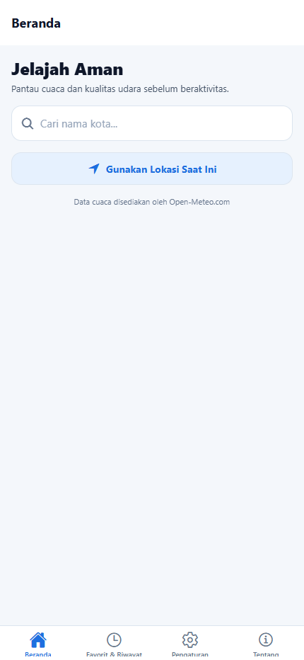
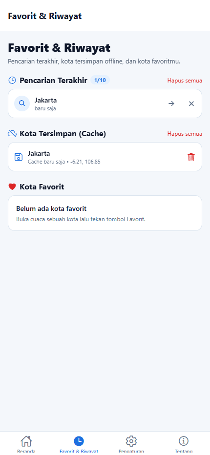
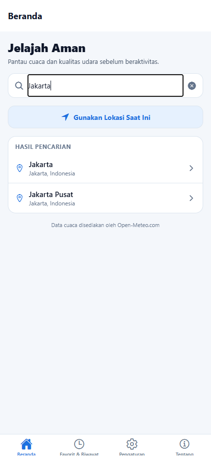
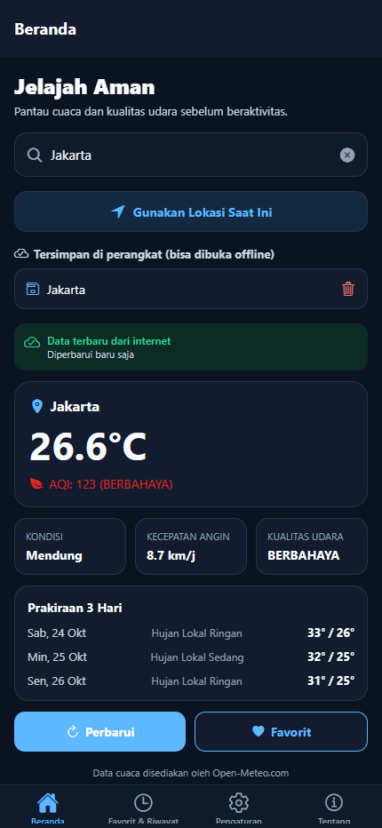
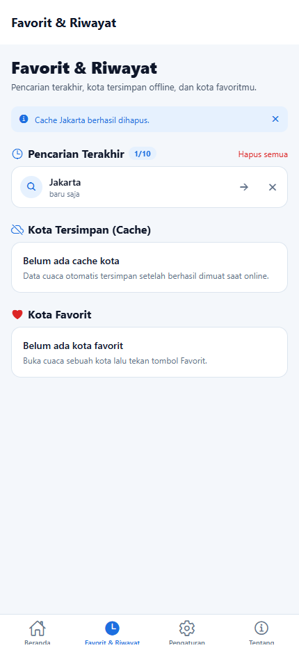
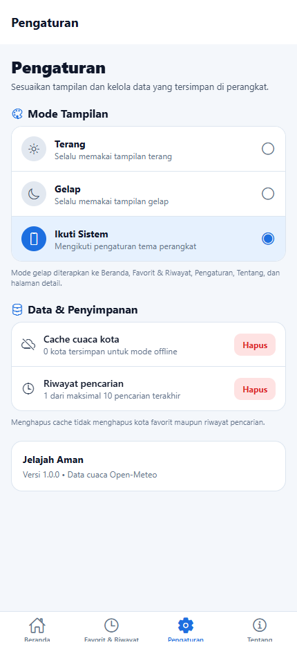
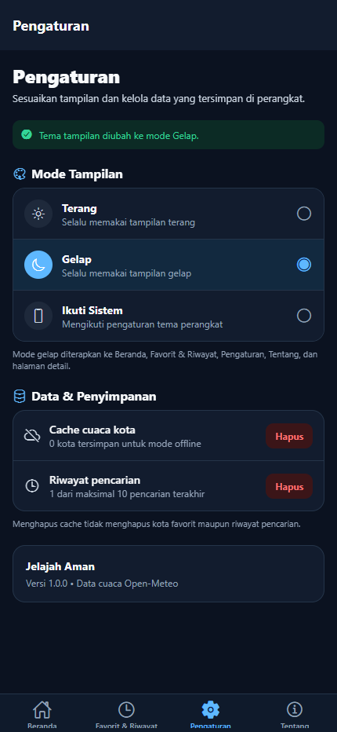
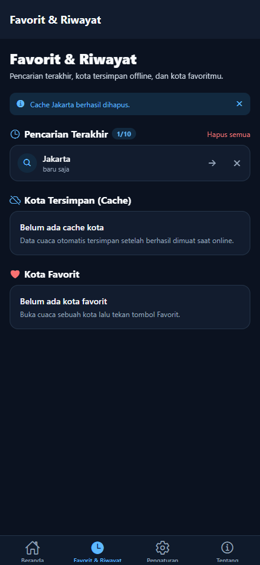
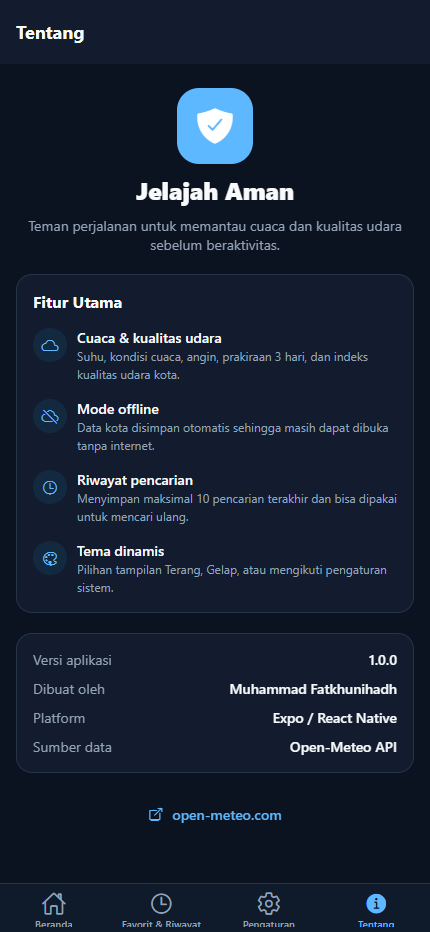
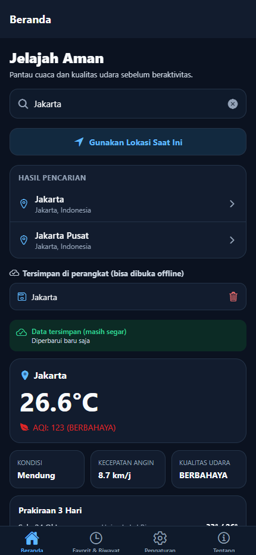

# LAPORAN PRAKTIKUM UTS

## Pemrograman Berbasis Platform

### Aplikasi “Jelajah Aman”

---

## Identitas Mahasiswa

| Keterangan | Isi |
| --- | --- |
| Nama | Muhammad Fatkhunihadh |
| NIM | 60324085 |
| Kelas | .................... |
| Mata Kuliah | Pemrograman Berbasis Platform |
| Jenis Penilaian | Ujian Tengah Semester (UTS) |
| Tanggal | 24 Oktober 2026 |

**Link Repository GitHub:**
[https://github.com/Nihadd-ux/orientasi-jelajah-aman](https://github.com/Nihadd-ux/orientasi-jelajah-aman)

> Repository disetel **Public** agar dapat diakses oleh dosen pengampu.

---

## 1. Pendahuluan

Aplikasi **Jelajah Aman** merupakan aplikasi cuaca berbasis Expo/React Native yang dikembangkan dari Praktikum Pertemuan 1–7. Aplikasi menampilkan cuaca, kualitas udara, prakiraan harian, pencarian kota, lokasi perangkat, mode offline berbasis cache SQLite, serta daftar kota favorit.

Pada UTS ini aplikasi disempurnakan dengan **empat fitur wajib**, yaitu:

1. Kustomisasi ikon tab bar dan perbaikan label navigasi.
2. Riwayat pencarian terakhir (*recent search history*) maksimal 10 pencarian.
3. Penghapusan cache kota per item dengan konfirmasi.
4. Implementasi tema gelap/terang/ikuti sistem pada seluruh layar.

Selain itu ditambahkan beberapa penyempurnaan opsional: tampilan antarmuka baru yang konsisten, detail cuaca dan prakiraan 3 hari, hapus riwayat/favorit dengan konfirmasi, serta perbaikan bug URL layanan geocoding.

---

## 2. Ringkasan Fitur yang Diimplementasikan

| No | Fitur UTS | Status | Bukti |
| --- | --- | --- | --- |
| 1 | Ikon tab bar unik + label navigasi | Selesai | Gambar 1, 2, 8 |
| 2 | Riwayat pencarian maksimal 10 + klik untuk mencari ulang | Selesai | Gambar 3, 4, 11 |
| 3 | Hapus cache kota per item + Alert konfirmasi | Selesai | Gambar 5, 6 |
| 4 | Tema Terang / Gelap / Ikuti Sistem | Selesai | Gambar 7–13 |
| 5 | Bonus: UI baru, prakiraan 3 hari, favorit, detail cuaca | Selesai | Gambar 3, 11 |

---

## 3. Implementasi Fitur

### 3.1 Kustomisasi Ikon Tab Bar dan Perbaikan Label Navigasi

**File:** `src/app/(tabs)/_layout.tsx`

Sebelumnya seluruh tab memakai ikon segitiga bawaan dan hanya memiliki label singkat “Riwayat”. Sekarang setiap tab memakai ikon **Ionicons** dari pustaka `@expo/vector-icons` yang representatif:

| Tab | Label baru | Ikon aktif / tidak aktif |
| --- | --- | --- |
| Beranda | Beranda | `home` / `home-outline` |
| Favorit & Riwayat | Favorit & Riwayat | `time` / `time-outline` |
| Pengaturan | Pengaturan | `settings` / `settings-outline` |
| Tentang | Tentang | `information-circle` / `information-circle-outline` |

Label “Favorit & Riwayat” dipakai agar fungsi peninjauan data favorit sekaligus riwayat pencarian lebih intuitif. Warna ikon aktif, warna latar tab bar, dan border juga mengikuti tema yang sedang aktif.

```tsx
<Tabs.Screen
  name="riwayat"
  options={{
    title: "Favorit & Riwayat",
    tabBarAccessibilityLabel:
      "Tab Favorit dan Riwayat, berisi pencarian terakhir, kota tersimpan, dan favorit",
    tabBarIcon: ({ color, focused, size }) => (
      <Ionicons name={focused ? "time" : "time-outline"} size={size} color={color} />
    ),
  }}
/>
```

**Gambar 1 — Tab bar dengan ikon unik dan label baru (mode terang):**



**Gambar 2 — Tab Favorit & Riwayat aktif (mode terang):**



---

### 3.2 Riwayat Pencarian Terakhir (Recent Search History)

**File:** `src/services/riwayatPencarian.ts`, `src/types/riwayat.ts`, `src/app/(tabs)/index.tsx`, `src/app/(tabs)/riwayat.tsx`

Mekanisme:

- Riwayat disimpan di **AsyncStorage** dengan kunci `@jelajah_aman:riwayat_pencarian`.
- Setiap kali pengguna memilih kota dari hasil pencarian, kota dicatat ke urutan paling atas.
- Duplikat kota yang sama tidak disimpan dua kali.
- Daftar dibatasi **maksimal 10 pencarian terakhir** menggunakan `.slice(0, 10)`.
- Setiap item menyimpan `id`, `nama`, `latitude`, `longitude`, dan `dicariPada`.
- Saat item riwayat diklik, aplikasi berpindah ke Beranda, **mengisi kolom pencarian**, lalu otomatis memuat cuaca kota tersebut.
- Riwayat dapat dihapus satu per satu atau seluruhnya.

```ts
const baru: KotaRiwayat[] = [
  { ...kota, dicariPada: Date.now() },
  ...tanpaDuplikat,
].slice(0, MAKS_RIWAYAT); // MAKS_RIWAYAT = 10
```

**Gambar 3 — Hasil pencarian kota Jakarta:**



**Gambar 4 — Daftar pencarian terakhir (1/10) beserta kota tersimpan dan favorit:**


**Gambar 5 — Klik riwayat otomatis mengisi pencarian dan memuat cuaca kota:**



---

### 3.3 Penghapusan Cache Kota dengan Konfirmasi

**File:** `src/services/cacheRepository.ts`, `src/utils/konfirmasi.ts`, `src/app/(tabs)/riwayat.tsx`, `src/app/(tabs)/index.tsx`, `src/app/(tabs)/pengaturan.tsx`

Fitur:

- Fungsi `hapusCache(kunci)` menghapus satu baris cache kota dari tabel SQLite `cache_cuaca`.
- Tombol **hapus (ikon tempat sampah)** tersedia pada setiap item **Kota Tersimpan (Cache)** di tab Favorit & Riwayat dan pada daftar kota tersimpan di Beranda.
- Sebelum menghapus, muncul **konfirmasi**:
  - Mobile/Expo Go: `Alert.alert` dengan tombol “Batal” dan “Hapus”.
  - Browser/web: `window.confirm` agar konfirmasi tetap berfungsi.
- Tersedia pula tombol “Hapus semua” untuk membersihkan seluruh cache (tetap dengan konfirmasi).
- Setelah cache dihapus, daftar langsung diperbarui dan pesan status ditampilkan.

```ts
export async function hapusCache(kunci: string): Promise<void> {
  const db = await ambilDatabase();
  await db.runAsync("DELETE FROM cache_cuaca WHERE kunci = ?", [kunci]);
}
```

**Gambar 6 — Kondisi setelah cache kota Jakarta dihapus (pesan sukses tampil, daftar cache kosong):**



> Pengujian otomatis juga menangkap teks dialog konfirmasi:
> “Hapus cache kota? Data cuaca Jakarta yang tersimpan di perangkat akan dihapus. Kota ini tidak dapat dibuka offline sampai dicari lagi saat online.”

**Gambar 7 — Pengaturan data & penyimpanan dengan tombol hapus cache:**



---

### 3.4 Tema Gelap / Terang / Ikuti Sistem

**File:** `src/contexts/tema-context.tsx`, `src/constants/theme.ts`, `src/hooks/use-theme.ts`, `src/app/_layout.tsx`, seluruh layar tab.

Mekanisme:

- `PenyediaTema` menyimpan mode pilihan pengguna (`terang`, `gelap`, `sistem`) di AsyncStorage dengan kunci `@jelajah_aman:mode_tema`.
- Mode `sistem` membaca `useColorScheme()` perangkat secara langsung.
- Palet warna lengkap tersedia untuk kedua mode: teks, latar, kartu, border, primary, danger, success, warning, input, tab bar, dan lainnya.
- `useTheme()` kini membaca konteks tema sehingga **semua layar dan komponen** berubah warna secara langsung:
  - Beranda
  - Favorit & Riwayat
  - Pengaturan
  - Tentang
  - Detail Cuaca
  - Modal Tambah Favorit
  - Kartu cuaca, status data, kotak pencarian, dan atribusi
- Header Stack, header Tabs, status bar, serta warna tab bar ikut menyesuaikan.
- Pilihan tema **tetap tersimpan setelah aplikasi ditutup/di-reload**.

```ts
const skema: SkemaWarna =
  mode === "sistem"
    ? skemaSistem === "dark" ? "dark" : "light"
    : mode === "gelap" ? "dark" : "light";
```

**Gambar 8 — Menu Pengaturan, pilihan mode tampilan (terang):**


**Gambar 9 — Mode Gelap dipilih dan langsung diterapkan:**



**Gambar 10 — Beranda mode gelap:**


**Gambar 11 — Favorit & Riwayat mode gelap:**



**Gambar 12 — Tentang mode gelap:**



**Gambar 13 — Tema gelap tetap aktif setelah halaman di-reload (persistensi):**



---

## 4. Fitur Tambahan (Bonus)

1. **Antarmuka baru yang lebih rapi** — kartu cuaca, kartu statistik (kondisi, angin, kualitas udara), prakiraan 3 hari, dan pesan status yang informatif.
2. **Riwayat pencarian yang dapat dikelola** — hapus satu item, hapus semua, dan pencarian ulang sekali ketuk.
3. **Daftar cache kota lengkap** di tab Favorit & Riwayat (maksimal 20 kota), lengkap dengan waktu cache dan koordinat.
4. **Hapus favorit dengan konfirmasi** agar tidak terhapus tidak sengaja.
5. **Halaman detail cuaca fungsional** — memuat data nyata berdasarkan koordinat, bukan angka statis.
6. **Aksesibilitas** — label aksesibilitas pada tombol, tab, input, dan kartu cuaca.
7. **Perbaikan bug** — URL layanan geocoding sebelumnya terpotong oleh baris baru (`format=jso\nn`) sehingga pencarian gagal. Sekarang diperbaiki menjadi `format=json`.

---

## 5. Struktur File Penting

```text
src/
├── app/
│   ├── _layout.tsx                 # PenyediaTema + Stack + StatusBar
│   ├── (tabs)/
│   │   ├── _layout.tsx             # Ikon tab bar + tema
│   │   ├── index.tsx               # Beranda, pencarian, riwayat, cache
│   │   ├── riwayat.tsx             # Favorit & Riwayat
│   │   ├── pengaturan.tsx          # Tema + hapus cache/riwayat
│   │   └── tentang.tsx             # Profil aplikasi
│   ├── detail/[kota].tsx           # Detail cuaca
│   └── tambah-favorit.tsx          # Modal favorit
├── components/                     # SearchBox, WeatherCard, StatusData, dll.
├── constants/theme.ts              # Palet terang & gelap
├── contexts/tema-context.tsx       # State tema + persistensi
├── services/
│   ├── cacheRepository.ts          # CRUD cache SQLite (termasuk hapusCache)
│   ├── riwayatPencarian.ts         # Riwayat maksimal 10
│   └── ...
├── types/riwayat.ts                # Tipe KotaRiwayat
└── utils/konfirmasi.ts             # Alert mobile + confirm web
```

---

## 6. Pengujian

| No | Skenario | Langkah | Hasil |
| --- | --- | --- | --- |
| 1 | Ikon tab | Buka aplikasi, lihat tab bar | 4 ikon berbeda tampil, label sesuai |
| 2 | Pencarian kota | Ketik “Jakarta” | Daftar hasil muncul (Jakarta, Jakarta Pusat, dst.) |
| 3 | Simpan riwayat | Pilih kota Jakarta | Kota masuk riwayat, badge 1/10 |
| 4 | Batas 10 | Pilih lebih dari 10 kota | Daftar tetap maksimal 10 dan tanpa duplikat |
| 5 | Klik riwayat | Ketuk item riwayat | Kembali ke Beranda, kolom terisi, cuaca dimuat |
| 6 | Hapus cache | Ketuk ikon hapus pada item cache | Konfirmasi muncul, setelah setuju cache hilang |
| 7 | Hapus semua cache | Pengaturan → Hapus | Konfirmasi muncul, jumlah cache menjadi 0 |
| 8 | Tema gelap | Pengaturan → Gelap | Seluruh layar berubah gelap |
| 9 | Tema terang | Pengaturan → Terang | Seluruh layar kembali terang |
| 10 | Ikuti sistem | Pengaturan → Ikuti Sistem | Tema mengikuti perangkat |
| 11 | Persistensi tema | Reload aplikasi | Tema terakhir tetap dipakai |
| 12 | Build & konsol | `npx tsc --noEmit`, export web, uji browser | Tidak ada error TypeScript maupun error konsol |

Pengujian web dilakukan menggunakan Chrome headless pada viewport 430×932. Hasil akhir: **0 error konsol** dan seluruh fitur berjalan.

---

## 7. Cara Menjalankan Proyek

```bash
# 1. Install dependency
npm install

# 2. Jalankan Expo
npx expo start

# 3. Pilih platform
#    a = Android / Expo Go
#    w = Web browser
```

Persyaratan:

- Node.js dan npm
- Expo Go (Android/iOS) atau browser modern
- Koneksi internet untuk pengambilan data cuaca pertama kali
- Izin lokasi opsional untuk fitur “Gunakan Lokasi Saat Ini”

---

## 8. Kesimpulan

Keempat fitur wajib UTS telah diimplementasikan dan berjalan secara fungsional di web serta siap dijalankan di Expo Go:

1. ✅ Ikon tab bar unik dengan `@expo/vector-icons` dan label “Favorit & Riwayat”.
2. ✅ Riwayat pencarian maksimal 10, tersimpan lokal, tanpa duplikat, dan dapat diklik untuk mencari ulang.
3. ✅ Penghapusan cache per kota dengan konfirmasi Alert pada setiap item.
4. ✅ Tema Terang, Gelap, dan Ikuti Sistem yang diterapkan dinamis ke seluruh layar serta tersimpan permanen.

Aplikasi juga dilengkapi fitur bonus berupa UI baru, prakiraan 3 hari, pengelolaan favorit, detail cuaca fungsional, serta perbaikan bug pencarian.

---

## 9. Tautan

- **Repository GitHub:** [https://github.com/Nihadd-ux/orientasi-jelajah-aman](https://github.com/Nihadd-ux/orientasi-jelajah-aman)
- **Sumber data cuaca:** [https://open-meteo.com/](https://open-meteo.com/)
- **Dokumentasi Expo:** [https://docs.expo.dev/](https://docs.expo.dev/)
